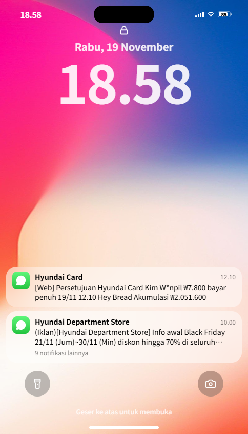
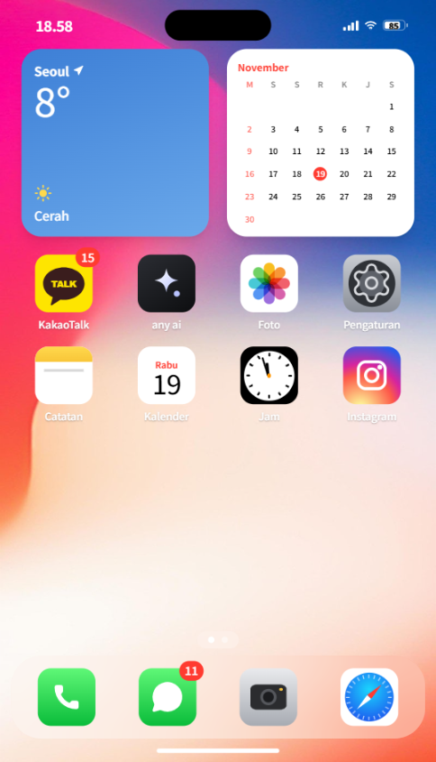
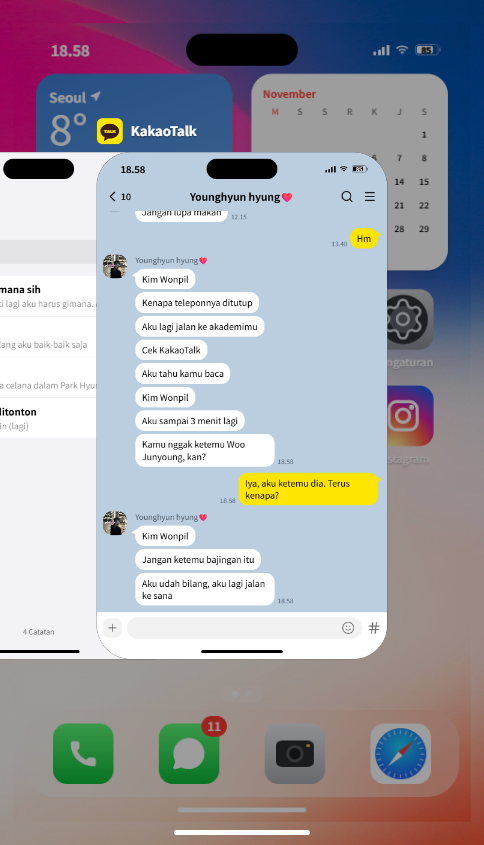
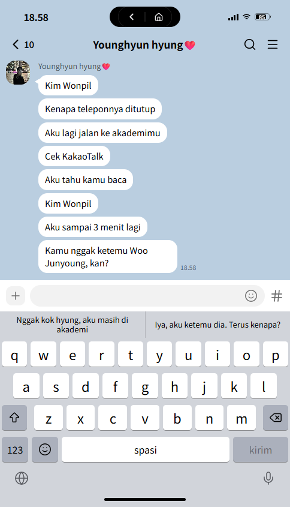
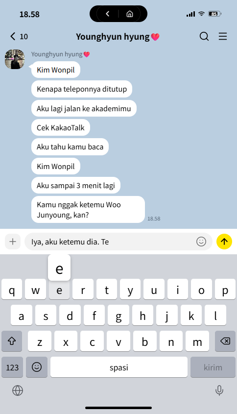
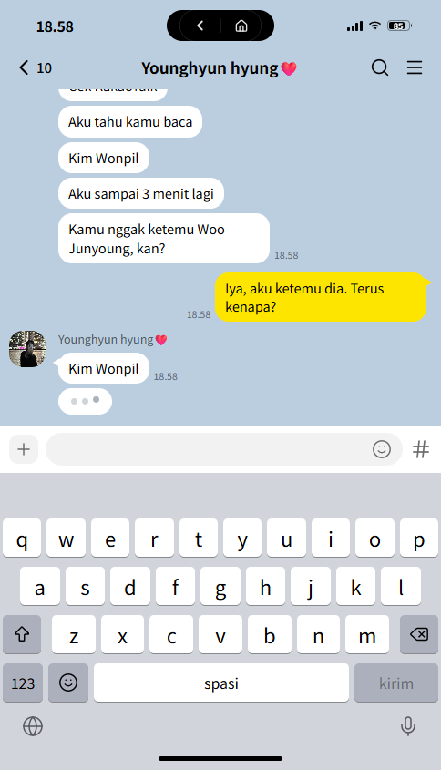

<div align="center">

# 📱 iphone Kim Wonpil

**Kisah fiktif yang mengikuti jejak-jejak di dalam sebuah iPhone.**

*Buka kuncinya, baca chat-nya, telusuri riwayat pencariannya, dan putuskan sendiri jawaban Wonpil.*

<br />


<br />


&nbsp;

&nbsp;


</div>

<br />

## ✨ Tentang

**iphone Kim Wonpil** adalah fiksi interaktif berbentuk iPhone yang berjalan di browser. Pemain memegang HP milik
Kim Wonpil, seorang guru piano di akademi *Youngwon Piano*, lalu mengikuti cerita lewat isi HP-nya: telepon masuk,
chat KakaoTalk, SMS, catatan, riwayat pencarian, foto, hingga memo suara.

Ceritanya bercabang. Jawaban yang dipilih pemain di chat menentukan balasan yang datang, dan setiap pilihan
membawa percakapan ke arah yang berbeda.

> 🇮🇩 Seluruh teks sudah dialihbahasakan ke bahasa Indonesia, tetapi kesan Koreanya tetap dijaga: nama tokoh,
> sapaan seperti *hyung* dan *-ssi*, serta emotikon ㅎㅎ ㅠㅠ tetap dipertahankan.

<br />

## 🎬 Sekilas

<div align="center">

| Keyboard & QuickType | Mengetik sendiri | Lawan bicara mengetik |
| :---: | :---: | :---: |
|  |  |  |

</div>

<br />

## 🌸 Fitur

### Terasa seperti iPhone sungguhan
- **Layar kunci & kode sandi.** Konten terangkat mengikuti jari saat digeser ke atas.
- **Home bar dengan gesture iOS.**
  - Geser ke atas: app menyusut dan terbang kembali ke ikonnya.
  - Geser lalu tahan: **App Switcher** terbuka dengan *live preview* setiap app.
  - Di App Switcher: geser horizontal dengan inersia, lempar kartu ke atas untuk menutup app, tap kartu untuk membukanya lagi.
- **Zoom dari ikon** saat membuka app, simetris dengan animasi menutup.
- **Physics berbasis spring** dengan parameter ala SwiftUI (`response`, `dampingFraction`), velocity jari yang diteruskan ke animasi, proyeksi inersia, dan *rubber band*.
- **Dynamic Island** tampil sama di PC maupun HP.

### Chat yang hidup
- **Keyboard iOS di layar** dengan bar **QuickType** berisi dua pilihan jawaban.
- Kalimat yang dipilih **terketik sendiri** huruf demi huruf dengan ritme seperti jari manusia, lengkap dengan pop-up tombol, **bunyi klik**, dan getar (Android).
- **Ketik bebas** tetap bisa, lewat keyboard fisik di PC maupun keyboard layar.
- Lawan bicara menampilkan **"sedang mengetik"** sebelum setiap balasan.
- Percakapan berlanjut **beberapa giliran** di setiap cabang cerita.

### Isi HP yang bisa dijelajahi
KakaoTalk · Pesan · Telepon · Safari (Naver) · Instagram · Catatan · Kalender · Jam · Foto · Memo Suara · CatchTable · any ai · Pengaturan

<br />

## 🎮 Cara Bermain

1. Tunggu telepon masuk, lalu angkat atau tolak.
2. Geser layar kunci ke atas dan masukkan kode sandi.
3. Jelajahi isi HP, baca chat yang berdatangan, dan balas ketika ditanya.
4. Tahan home bar untuk berpindah antar-app lewat App Switcher.

<details>
<summary>🔑 <b>Petunjuk kode sandi</b> (spoiler)</summary>
<br />

Kode sandinya **1219**.

</details>

<details>
<summary>🔄 <b>Mulai dari awal</b></summary>
<br />

Buka **Pengaturan → Mulai Ulang Cerita**. Progres cerita dan daftar app terbaru hanya disimpan di
`sessionStorage`, jadi menutup tab juga akan mengulang cerita.

</details>

<br />

## 🛠️ Teknologi

| | |
| --- | --- |
| **Framework** | [Next.js 16](https://nextjs.org) (App Router, Turbopack) & React 19 |
| **Bahasa** | TypeScript |
| **Styling** | Tailwind CSS 4 & shadcn/ui |
| **Animasi** | [Motion](https://motion.dev) untuk spring dan motion value, ditulis langsung ke DOM tanpa re-render per frame |
| **Ikon** | lucide-react |
| **Suara** | `<audio>` untuk efek cerita & Web Audio API untuk klik keyboard |
| **State** | React Context + `sessionStorage` (tanpa backend) |

<br />

## 🚀 Menjalankan Secara Lokal

Project ini memakai **pnpm 12** (lihat `packageManager` di `package.json`).

```bash
# install dependency
npx pnpm@12.3.4 install

# jalankan server development
npx pnpm@12.3.4 dev
```

Buka [http://localhost:3000](http://localhost:3000). Kalau pnpm global Anda sudah versi 12, cukup `pnpm install` dan `pnpm dev`.

```bash
# build production
npx pnpm@12.3.4 build
npx pnpm@12.3.4 start
```

<br />

## 📂 Struktur Project

```
app/                      halaman & layout Next.js
components/
  apps/                   setiap app di dalam HP (KakaoTalk, Safari, Instagram, ...)
  phone/
    app-stage.tsx         kartu app, gesture home bar, App Switcher, zoom ikon
    ios-keyboard.tsx      keyboard iOS + bar QuickType
    lock-screen.tsx       layar kunci dengan unlock mengikuti jari
    chrome.tsx            status bar, Dynamic Island, home indicator
lib/
  motion/ios-physics.ts   preset spring, proyeksi inersia, rubber band
  story/                  isi cerita: kontak, chat, SMS, event, waktu
    store.tsx             state cerita, pengiriman pesan & balasan
    auto-reply.ts         pencocokan jawaban bebas ke cabang cerita
    reply-scripts.ts      naskah giliran percakapan & pilihan QuickType
    app-presence.tsx      membedakan app aktif dan pratinjau App Switcher
public/                   wallpaper, foto, stiker, suara
```

<br />

## ☁️ Deploy

Aplikasi ini **sepenuhnya frontend**: tidak ada API route, server action, maupun database. Halamannya
di-prerender sebagai file statis, jadi bisa langsung dideploy ke **Vercel** tanpa server tambahan.

1. Import repo ini di [Vercel](https://vercel.com/new).
2. Deploy, tanpa perlu environment variable.
3. Jika instalasi gagal karena versi pnpm, tambahkan `ENABLE_EXPERIMENTAL_COREPACK=1` di pengaturan project.

Workflow **GitHub Pages** juga tersedia di `.github/workflows/deploy-pages.yml` (build statis dengan `output: 'export'`).

<br />

## 💌 Catatan

Ini adalah karya penggemar yang **sepenuhnya fiktif**. Disusun berdasarkan cerita karya Postype
*'나의 무심한 다정에게'* (Untuk Kelembutanku yang Acuh). Seluruh percakapan, nomor, dan kejadian di dalamnya
hanyalah bagian dari cerita.

<br />

<div align="center">

*Dibuat dengan 🎹 dan sedikit rasa cemburu.*

</div>
